# AgroControl IoT

Sistema modular de monitoreo ambiental y gestión de finca para café, frijol,
maíz y arroz. El dashboard usa simulación local segura, persistencia SQLite,
exportación CSV, autenticación por roles y alertas SMTP opcionales. Las
interfaces de sensor y actuadores están separadas para facilitar una futura
conexión a SHT31 y GPIO de Raspberry Pi.

## Puesta en marcha

```bash
python -m venv venv
# Windows
venv\Scripts\activate
# Raspberry Pi OS / macOS / Linux:
# source venv/bin/activate
pip install -r requirements.txt
streamlit run app.py
```

Accede a `http://localhost:8501`. En el modo local, usa `operador` /
`agrocontrol` para monitorear y `admin` / `agrocontrol-admin` para cambiar
parámetros. Cambia la contraseña de administración con
`AGRO_ADMIN_PASSWORD` antes de cualquier despliegue.

Las mediciones se almacenan en `data/agrocontrol.db` y también pueden
descargarse como CSV desde el historial. El intervalo predeterminado del
dashboard es de 2 segundos y puede pausarse desde la barra lateral.

## Gestión de finca

El panel incluye una primera versión operativa para:

- Registrar parcelas y vincular café, frijol, maíz o arroz a una temporada.
- Simular humedad del suelo por parcela y clasificarla como seca, óptima o
  húmeda; el adaptador queda preparado para sensores físicos.
- Registrar gastos en colones costarricenses (CRC).
- Registrar cosechas en kg y consultar su conversión a quintales.
- Descontar ventas del inventario y calcular ingresos y margen estimado.

Las tablas agrícolas no generan gastos, ingresos ni cosechas ficticias. Se
crean vacías y el administrador debe registrar los datos reales. La conversión
de referencia usada para mostrar quintales es configurable en el módulo de
datos y actualmente usa 46 kg por quintal; debe confirmarse con la práctica
comercial de la finca.

Para alertas por correo configura fuera del código:

```text
AGRO_SMTP_HOST=smtp.example.com
AGRO_SMTP_PORT=587
AGRO_SMTP_USER=usuario
AGRO_SMTP_PASSWORD=secreto
AGRO_ALERT_EMAIL=destinatario@example.com
```

Al iniciar, `datos.py` crea `config/configuracion.json` si falta y genera 120
lecturas demostrativas en `data/registros.csv` cuando no existe un historial.
Las lecturas nuevas se validan contra los rangos físicos del SHT31
(15–40 °C y 40–90 %), y las reglas de decisión dependen del tipo de grano:

| Grano | Temperatura máxima | Humedad máxima |
| --- | ---: | ---: |
| Arroz | 25 °C | 65 % |
| Frijol | 22 °C | 60 % |

## Matriz de pruebas de estados

La siguiente matriz se ejecuta en `tests/test_casos_validacion.py` y documenta
los estados esperados del motor de decisiones:

| Caso de prueba | Entrada (T, H, grano) | Resultado esperado | Estado / actuador |
| --- | --- | --- | --- |
| Límite exacto arroz | 25.0 °C, 65.0 %, arroz | Condición en umbral seguro | `OPTIMO` / apagado |
| Exceso de temperatura arroz | 26.5 °C, 50.0 %, arroz | Activar enfriamiento | `ENFRIAMIENTO` / Relé 1 ON |
| Exceso de humedad frijol | 20.0 °C, 64.0 %, frijol | Activar extracción | `EXTRACCION_HUMEDAD` / Relé 2 ON |
| Caso crítico doble | 28.0 °C, 70.0 %, arroz | Alerta máxima | `RIESGO_CRITICO` / Relés 1 y 2 ON |
| Entrada inválida | Texto no numérico, 50.0 % | Bloqueo por validación | Rechazado sin guardar en CSV |

Ejecutar las pruebas sin instalar herramientas adicionales:

```bash
python -m unittest discover -s tests -v
```

## Módulos

- `validaciones.py`: tipos y rangos físicos.
- `logica.py`: estados `OPTIMO`, `ENFRIAMIENTO`, `EXTRACCION_HUMEDAD` y `RIESGO_CRITICO`.
- `datos.py`: JSON, CSV y datos semilla.
- `analisis.py`: métricas y agrupaciones por hora.
- `graficos.py`: figuras Matplotlib.
- `app.py`: panel Streamlit e historial.
- `sensor.py`: lectura simulada y punto de integración del SHT31.
- `actuadores.py`: estado seguro de relés simulados.
- `auth.py`: autenticación local con PBKDF2.
- `alertas.py`: envío SMTP explícito y configurable.
- `agrodatos.py`: parcelas, cultivos, suelo, gastos, cosechas, inventario y
  ventas en SQLite.

## Mapa conceptual de Fundamentos de Programación

```mermaid
graph TD
    classDef main fill:#1E1B4B,stroke:#6366F1,stroke-width:3px,color:#FFFFFF,font-weight:bold;
    classDef basico fill:#064E3B,stroke:#10B981,stroke-width:2px,color:#ECFDF5;
    classDef control fill:#7C2D12,stroke:#F97316,stroke-width:2px,color:#FFEDD5;
    classDef funciones fill:#4C1D95,stroke:#A855F7,stroke-width:2px,color:#F3E8FF;
    classDef datos fill:#164E63,stroke:#06B6D4,stroke-width:2px,color:#ECFEFF;
    classDef algoritmos fill:#713F12,stroke:#EAB308,stroke-width:2px,color:#FEF9C3;

    ROOT[💻 Proyecto: Fundamentos de Programación]:::main

    ROOT --> B[🟢 1. Conceptos Básicos]:::basico
    B --> B1[Variables y Constantes]
    B --> B2[Tipos de Datos: Int, Float, String, Bool]
    B --> B3[Operadores Aritméticos y Lógicos]

    ROOT --> C[🟠 2. Estructuras de Control]:::control
    C --> C1[Condicionales: If / Else]
    C --> C2[Bucles: For / While]

    ROOT --> F[🟣 3. Funciones y Modularidad]:::funciones
    F --> F1[Parámetros y Argumentos]
    F --> F2[Valores de Retorno]
    F --> F3[Alcance de Variables / Scope]

    ROOT --> D[🔵 4. Estructuras de Datos]:::datos
    D --> D1[Arreglos / Arrays Uni y Multidimensionales]
    D --> D2[Listas y Matrices]

    ROOT --> A[🟡 5. Lógica y Algoritmos]:::algoritmos
    A --> A1[Pseudocódigo y Diagramas de Flujo]
    A --> A2[Pruebas de Escritorio y Depuración]
```



### Leyenda cromática

- **Índigo profundo:** núcleo y estructura principal del proyecto.
- **Verde esmeralda:** conceptos básicos y fundamentos.
- **Naranja cálido:** decisiones y repeticiones del flujo de control.
- **Violeta eléctrico:** funciones, reutilización y modularidad.
- **Cian / turquesa:** organización de estructuras de datos.
- **Dorado / ámbar:** algoritmos, resolución y validación lógica.
